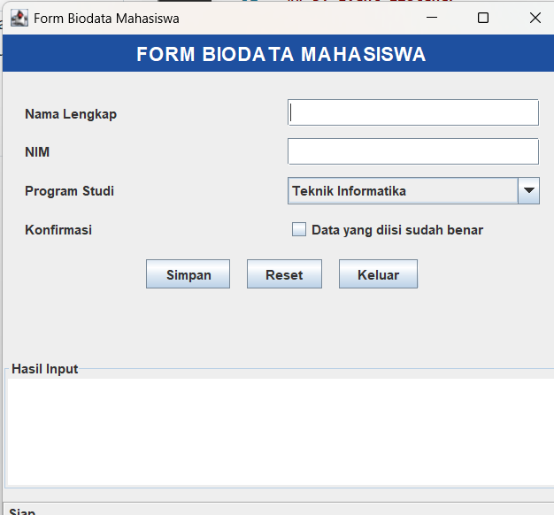
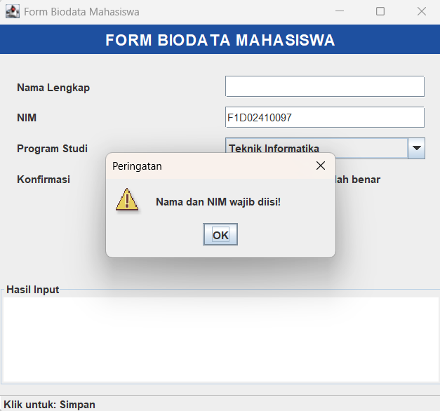
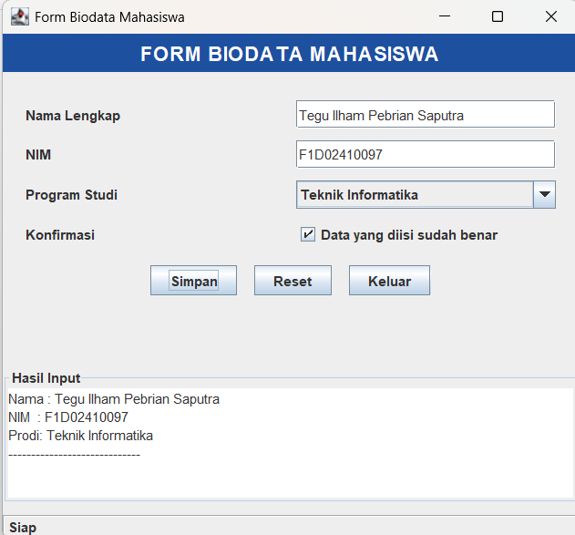
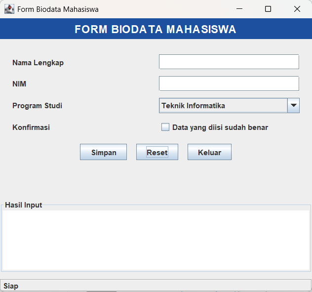
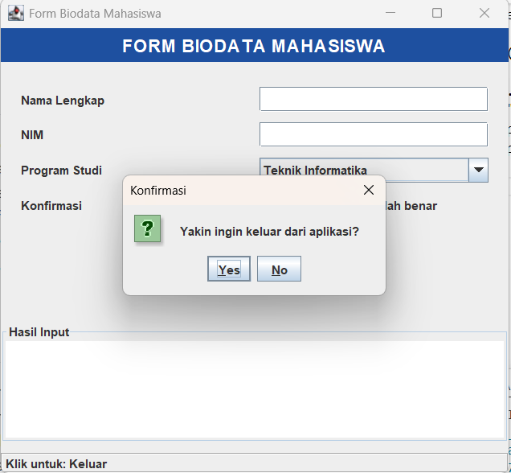

# F1D02410097-Tugas-GUI

## Nama: Tegu Ilham Pebrian Saputra
## NIM: F1D02410097

## Deskripsi 
program ini adalah sebuah program yang berfungsi untuk mencatat nama, nim, dan juga program studi dari mahasiswa atau dalam kata lain mengisi biodata mahasiswa. Di dalam program ini memuat 5 komponen utama GUI yaitu Top-level Container, Intermediate Container,  Atomic Component, Layout Classes,  hingga Event Listener.

## Komponen GUI yang digunakan
## 1. Top-level Container
Di dalam top level container ini saya menggunakan JFrame sebagai wadah paling atas untuk menampung komponen komponen lain yang akan digunakan.
## 2. Intermediate Container
di bagian ini saya menggunakan lima Intermediate Container, yaitu:
a. panelHeader (JPanel), menampung judul berlatar biru.
b. panelForm (JPanel), menampung label dan isian data.
c. panelTombol (JPanel), menampung tiga tombol.
d. scrollHasil (JScrollPane), membungkus areaHasil dan memberi scrollbar otomatis saat teks melebihi area tampilan.
e. panelTengah (JPanel), menggabungkan panelForm, panelTombol, dan scrollHasil.
## 3. Atomic Component
pada bagian ini saya menggunakan beberapa bagian atomic component, yaitu:
a. JLabel (lblJudul, lblNama, lblNim, lblProdi dan lblStatus), menampilkan teks statis atau status
b. JTextField (txtNama dan txtNim),	menerima input teks satu baris
c. JComboBox (cmbProdi),	memilih satu program studi dari daftar
d. JCheckBox	(chkSetuju),	konfirmasi benar/salah (dicentang atau tidak)
e. JButton	(btnSimpan, btnReset, btnKeluar),	memicu aksi saat diklik
f. JTextArea	(areaHasil),	menampilkan hasil input multibaris (setEditable(false) membuatnya hanya-baca)
## 4. Layout Classes
dalan code ini saya menggunakan tiga layout, yaitu:
a. BorderLayout membagi container menjadi lima area (NORTH, SOUTH, EAST, WEST, CENTER). Frame utama memakainya (setLayout(new BorderLayout(10, 10))) untuk meletakkan header di atas, panelTengah di tengah, dan status bar di bawah. panelTengah juga memakainya untuk menyusun form, tombol, dan hasil secara vertikal.
b. GridLayout membagi container menjadi sel-sel berukuran sama dalam baris dan kolom. panelForm memakai new GridLayout(4, 2, 10, 10), yaitu 4 baris dan 2 kolom. Setiap baris berisi pasangan label dan isian, sehingga semua kolom isian sejajar dan sama lebar.
c. FlowLayout menyusun komponen berurutan dari kiri ke kanan dan pindah baris jika ruang tidak cukup. panelHeader dan panelTombol memakainya dengan perataan tengah (FlowLayout.CENTER), sehingga judul dan ketiga tombol berada di tengah dengan jarak 15 piksel antar tombol.
## 5. Event Listener
dalam code ini saya menggunakan empat buat listener yaitu:
a. ActionListener (interface). Class Biodata mengimplementasinya dan meng-override actionPerformed(ActionEvent e). Listener ini didaftarkan ke ketiga tombol lewat addActionListener(this). Di dalam method, e.getSource() dipakai untuk membedakan tombol mana yang diklik, lalu menjalankan logika simpan, reset, atau keluar.
b. MouseAdapter (adapter class). Dibuat sebagai anonymous class dengan meng-override mouseEntered() dan mouseExited(). Saat kursor masuk ke area tombol, warna latar berubah dan status bar menampilkan "Klik untuk: ...". Saat kursor keluar, tampilan kembali ke semula.
c. KeyAdapter (adapter class). Meng-override keyTyped() pada txtNim. Jika karakter yang diketik bukan huruf atau angka (!Character.isLetterOrDigit(...)), e.consume() membatalkan event sehingga karakter itu tidak muncul di kolom.
d. WindowAdapter (adapter class). Meng-override windowClosing() agar saat tombol X  atau menu "keluar" diklik, yang dipanggil adalah konfirmasiKeluar(), bukan penutupan langsung. Ini pasangan dari DO_NOTHING_ON_CLOSE di bagian top-level container.

